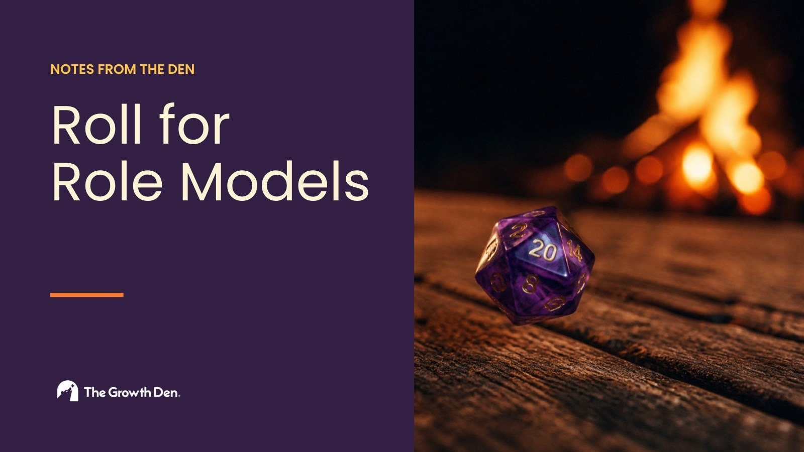

Five of my friends came over last night to play Dungeons &amp; Dragons around a bonfire in my backyard. Six men, all in our 30s and early 40s - and we never actually got around to the session.

The first hour went to roasting hot dogs and to my 6-year-old Ruth, who asked if she could run a session. No dice, no character sheets, nothing. Just her leading six grown men through a story by firelight, theater of the mind. Kasey has told me at least 3 times since then “Can you imagine the power trip I would have gotten as a kid having 6 grown adults letting me boss them around like that?”

She took us through Greek mythology. We pissed off Zeus, then Ares, then Poseidon, then Demeter, and eventually got ourselves trapped in Tartarus, where she subjected us to the same torture Tantalus got, food and water always just out of reach. A few of us learned quite a bit about Greek mythology from my 6-year-old last night, but I digress. 

Then she went to bed, and we didn't play. We sat around the fire for the rest of the night and talked about our lives.

We talked about how excited all six of us were that the blue wave actually landed, and what that means for our daughters' futures. We talked about couples therapy, because several of the group are in it right now, why they went, and what tools they're picking up there. Over half the group goes to therapy of some kind, couples or individual, mostly to work through family trauma from a long time ago. We talked about the pets we've lost. And we spent a long time talking about the male loneliness epidemic, because every one of us has felt it.

It’s genuinely a measured thing. In 1990, 3% of American men said they had no close friends at all. <a href="https://www.nationalreview.com/2021/07/american-men-suffer-a-friendship-recession/">By 2021 that was 15%</a>. Over the same stretch, the share of men with six or more close friends fell from 55% to 27%. In a given week, <a href="https://www.americansurveycenter.org/research/the-state-of-american-friendship-change-challenges-and-loss/">only about one in five men</a> says he got emotional support from a friend. And <a href="https://news.gallup.com/poll/690788/younger-men-among-loneliest-west.aspx">Gallup found last year</a> that a quarter of American men under 35 feel lonely for a lot of the day, more than women their age and more than their peers in almost every other wealthy country.

All six of us are neurodivergent to some extent, ADHD or otherwise, and most of us are extroverts or some kind of extrovert-introvert blend. So we constantly crave external stimulation. Meeting up with a group of friends, going out to a restaurant, a trivia night, a football game. We want it badly. But we truly don't know how to ask for what we need, most of the time.

That's what D&amp;D is for us. Nobody texts five friends "come over and tell me how your marriage is going." You text "D&amp;D Thursday at my place, add to your calendar so you don’t forget." The sessions are fun of course, but the time spent talking and building relationships is worth more than a hundred chances to dive into a fantasy game.

My kids are growing up watching this. Six men who show up for each other, who go to therapy, who get choked up about a dog, who ask each other how it's actually going. This is the framework of healthy male role models my children get to observe, build relationships with, and model their future selves on. Their future friends, their future partners, all of it.

I am so proud that this is the community we've cultivated. If you don't have one, I'd push you to start one. Find three or four people, give it a night, and put something in the middle of the table so nobody has to admit they came for the conversation. Ours happens to be D&amp;D. I hope you find yours, and I hope your kids are around when you do.

