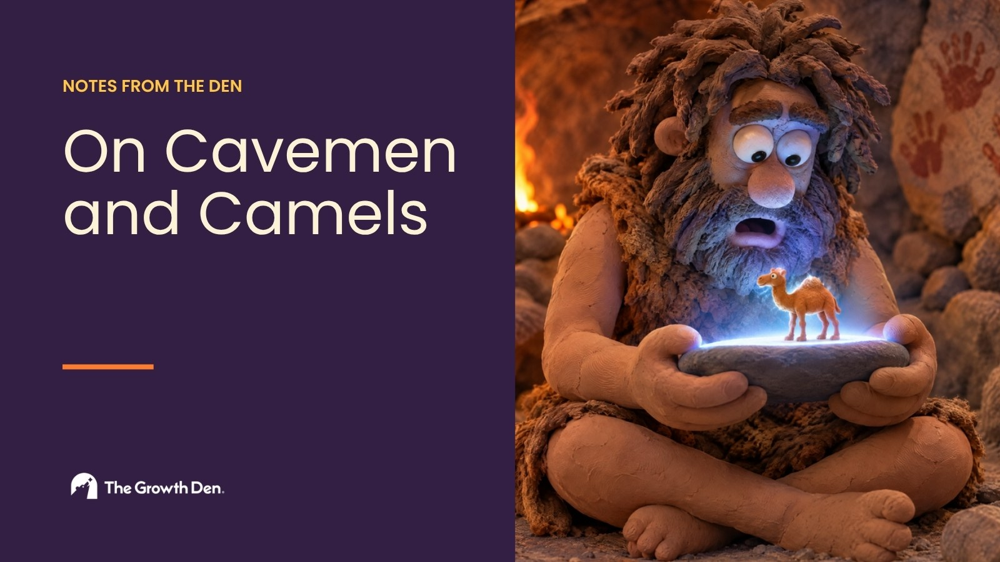

Imagine you're a time traveler from the Stone Age. You've never seen an advertisement in your life, and you land in a major city in the year 2026 through some kind of timey-wimey wibbly-wobbly nonsense.

There are magical boxes zooming faster than horses that almost knock you over. There are tall caves with artificial light blinding you from them. There are no trees anywhere you look. And on top of all that, you're buried in ads. Billboards. Print. Everywhere you look, people are staring at lit-up stones in their hands that shine like the sun, and handing money (another thing you have no concept of) to companies based on what they see on the stones.

Your first question is the obvious one. What the hell is anyone doing? Shouldn't they be out hunting? Tending crops? Making a fire? Instead they're walking around looking at a shiny rock and giving things to strangers for stuff they may or may not need.

But you are, of course, an intelligent caveman, so you start to piece it together. Their basic needs are met. Nobody hunts elk. Another company heats the home. They work, they get paid, and they spend what's left over on something else.

So you look at the something else. They're on "social media," so you figure they're being social, talking to friends. Well, no. They're flicking a finger across the shiny stone over and over, watching people they've never met show off a life they have no connection to. People on a boat in another part of the world, while they're completely landlocked. People in extremely fancy clothes that don't look like they came off a saber-tooth tiger at all. And then they buy that stuff.

Now, intelligent cave person, why? You start noticing the ads behind the buying, and you hear from the people who run them, the ones who think they know best: "Oh yes, the media mix here is ideal because we can get cheap CPMs, and our MER is efficient."

None of that means anything to you. So you ask the only questions that do. Why should someone buy this? Why should I give you money through my shiny rock? What do I get for it? Am I better off giving my money to you or to someone else? And why does it matter what your Cee Pee Emm is?

Here's the crux. To someone who has never seen the modern world, the absurdity is obvious. To the rest of us, everything is so mired in normalcy that we never stop to think about it. We spend our days on magic boxes that emanate light instead of out in the world with each other. We spend our money on things that may or may not make us any happier. And as marketers, we hold ourselves accountable to numbers that don't mean anything on their own. Sure, they tell you something about the "health" of the business. But marketing was never about an efficient acquisition cost. It's about finding someone who has a need and helping them solve it, and building something you're proud of along the way.

So think like a caveman more often. Don't take anything for granted. Look at every decision and ask whether it's actually a good business decision or whether you're just following fictitious numbers.

<h2>The camel</h2>

This reminds me of a story from early in my career. I was an analyst at Anheuser-Busch, and the head of my department, a guy named Joaquin, pulled me aside one day and asked, "Iceman, what would you do if there was a camel in your cubicle?"

Joaquin was famous for his many, many mixed metaphors, so I ran with it. I told him I'd go find him, or Pablo, and ask why there was a camel in my cubicle. "Good. What if it was there the next day?" he asked. Same thing, I guess.   "Yes, good, good Iceman! What if it was there every day for six months?" Well, by then I'd have gotten to the bottom of it and assumed the camel was there for good.   "Exactly! Yes. Now it's been there six months, and the next day it's gone. What do you do?" I'd ask you where the camel went.

"Exactly, Iceman. When something is always there, you stop seeing it. You have to always be looking for the camel."

That's the whole thing. We get so used to the way advertising is done, and the way businesses are run, that we stop seeing the camels in the room. We stop asking why we do any of it, or whether it's creating real value for a real person.

So go look for the camels in your own work, whatever line of work it is, and make sure you're focused on driving value to people. Stop being complacent.

